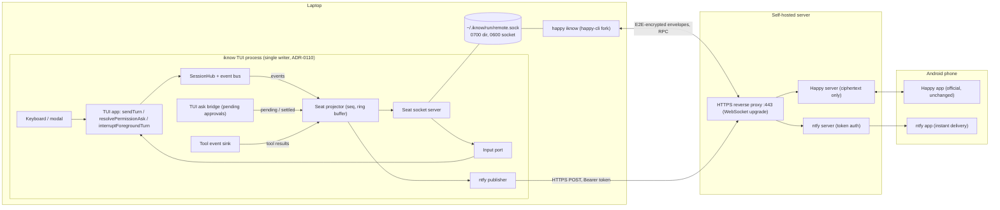

# Spec: remote-sync — the phone monitors and steers the live TUI session

**Status:** active — 2026-10-20.
**Decision SSOT:** `docs/adr/0149-phone-remote-through-happy.md` (builds on ADR-0110, ADR-0147).
**Surface:** iknow — `src/session-api/hub.ts` (event bus), `src/remote-api/` (new: protocol, codec, socket server, ring buffer, ntfy publisher), `src/tui/remote/` (new: seat assembly, projector, input port), `src/tui/ask-user.ts`, `src/tui/app.tsx`, `src/tui/run.tsx`, `src/config/settings.ts`. Happy — a fork of `packages/happy-cli` (new `src/iknow/`, `src/index.ts`, `src/utils/createSessionMetadata.ts`). Deployment — self-hosted Happy server and ntfy server.
**Plan:** `plans/remote-sync-plan1.md`.
**Anchors:** iknow `path:line` anchors are verified at master `20cb6384`. Happy anchors are verified at `slopus/happy` commit `b99e7f83a4162b2ab6ed999fafa2398f9cc1d237` and prefixed with the package (`happy-cli/`, `happy-app/`, `happy-wire/`, `happy-server/`).

## Goal

From an Android phone, the operator watches and steers the same live session the laptop TUI shows: the transcript streams to both, a message typed on either side runs in that session, an approval can be answered on either side and closes on both, and an abort from the phone stops the turn the same way Esc does. Remote permissions are local permissions.

**Users:** the operator away from the laptop with a running TUI session.

## 1. Terms

- **remote seat** — the TUI-hosted listener on `<dataDir>/run/remote.sock` and everything behind it in the TUI process (projector, input port). One per TUI process, at most one per data dir.
- **hub event bus** — `SessionHub.subscribeEvents`: every stream event of every turn, plus host events, delivered to any number of subscribers.
- **input port** — the three remote operations (send message, answer approval, abort), bound by the TUI to the functions its keyboard already uses.
- **seat protocol** — the NDJSON protocol on the socket (§5), version `1`.
- **iknow backend** — the `happy iknow` command of the happy-cli fork: a seat client on one side and a Happy session client on the other.
- **instance id** — a random UUID the seat generates at start; it names one TUI process lifetime.

## 2. Components and responsibilities



| Component         | Lives in                                 | Responsibility                                                                                                                                                                                              |
| ----------------- | ---------------------------------------- | ----------------------------------------------------------------------------------------------------------------------------------------------------------------------------------------------------------- |
| Hub event bus     | `src/session-api/hub.ts`                 | Publish every stream event of every turn / continuation / compaction, plus `user_message`, `turn_started`, `turn_ended`, to all subscribers. Listener faults never reach the turn.                          |
| Seat projector    | `src/tui/remote/projector.ts`            | Merge bus, ask bridge and tool sink into one ordered event stream for the active conversation; assign `seq`; keep the ring buffer; build snapshots; hold streamed tool calls until their input is complete. |
| Input port        | `src/tui/remote/input-port.ts`           | Registry the TUI app binds at mount; routes `send_message`, `answer_approval`, `abort` to `sendTurn`, `resolvePermissionAsk`, `interruptForegroundTurn`.                                                    |
| Socket server     | `src/remote-api/socket-server.ts`        | Own the socket file and its permissions; NDJSON framing; handshake; per-connection subscription, catch-up and back-pressure. Host-neutral (no `src/tui/` imports).                                          |
| Protocol / codec  | `src/remote-api/protocol.ts`, `codec.ts` | Message types, version list, line codec and size limits. Host-neutral.                                                                                                                                      |
| ntfy publisher    | `src/remote-api/notify-ntfy.ts`          | Publish minimal notifications on approval pending and turn end.                                                                                                                                             |
| Seat assembly     | `src/tui/remote/seat.ts`                 | Read `remote` settings, start / stop the seat with the TUI lifetime, wire the parts above.                                                                                                                  |
| iknow backend     | happy-cli fork `src/iknow/`              | Seat client ↔ Happy session client: envelopes, agent state, RPC handlers, reconnection.                                                                                                                     |
| Happy server      | self-hosted                              | Store-and-forward of encrypted session data and RPC between the backend and the app.                                                                                                                        |
| Happy app         | phone                                    | Transcript, composer, permission cards, abort. Unchanged official build.                                                                                                                                    |
| ntfy server / app | self-hosted / phone                      | Wake the operator for approvals and finished turns.                                                                                                                                                         |

## 3. Invariants

1. The TUI process is the only writer of the session (ADR-0110). Neither the seat nor the backend opens a session file.
2. Every remote input enters through the same TUI function as the matching keyboard input; the seat holds no turn, queue or approval state of its own beyond the projection.
3. One approval is settled once. The first answer from any side wins; every later answer gets `not_pending` and changes nothing.
4. No approval has a default timeout (ADR-0147 R4). A configured `approval.timeoutMs` applies to the question, not to a side.
5. A remote answer cannot widen permissions beyond what the modal can do: once, always (tool-level session grant), reject. The permission mode is not remotely settable.
6. The socket is reachable only by its owner: directory `0700`, socket `0600`, both owned by the TUI's uid; a symlinked or foreign-owned directory refuses to start the seat.
7. Seat, projector and publisher faults never fail, delay or alter a turn.
8. ntfy messages never carry code, paths, prompts, tool input or model output.

### 3.1 Local lifecycle contract

TUI readiness belongs to the local TUI lifecycle, not to any remote surface:

- Optional startup work — MCP first-ready work, model-gateway initialization and probes, the remote seat, notification publishing — never prevents usable input or quit; its faults surface as notices at most, never as a startup failure. A missing required local model, provider or key remains an explicit startup error raised before the UI is usable.
- Accepted `post` / `continue` work has exactly one terminal outcome — success, cancellation or failure. Compaction carries its own independent correlation and is never presented as a turn.
- Switching the active conversation refreshes the projection without stopping the outgoing turn; late events from the outgoing conversation cannot corrupt the new projection. Approvals remain first-answer-wins across conversations (invariant 3).
- Snapshot plus live delivery has no sequence gap and no duplicate: a reconnect either replays from the retained ring or starts from a fresh snapshot (§5.7).
- `remote.notify` works independently of `remote.enabled` (§4.5); a notification failure never delays or changes a turn (invariant 7).

## 4. iknow changes

### 4.1 Hub event bus

- `SessionHub.subscribeEvents(listener: (e: HubEvent) => void): () => void`.
- `HubEvent` = `{ kind: "stream", conversationId, turnId, event: HarnessStreamEvent }` | `{ kind: "user_message", conversationId, text, origin: "local" | "remote" }` | `{ kind: "turn_started", conversationId, turnId }` | `{ kind: "turn_ended", conversationId, turnId, outcome: TurnOutcomeView }`.
- Publish points: the `wrappedOnStream` of `postMessage` (`hub.ts:3204-3209`) and of `continueSession` (`hub.ts:4040-4045`); the compaction stream of `compactSession` (`hub.ts:3871` — wrap instead of passing `opts.onStream` through). `wakeFromSubagent` delegates to `postMessage` with `silent: true` (`hub.ts:3686-3692`) and is covered by it.
- `user_message` is published when `postMessage` accepts a non-silent message; `postMessage` gains `origin?: "local" | "remote"` (default `local`), passed through `TuiBridge.postMessage` (`src/tui/hub-bridge.ts:178-185`, `:582-603`).
- `turnId` is an opaque per-turn id the hub generates for the bus; it is not persisted.
- Each listener call is guarded like `safeEmitStream` (`src/harness/stream.ts:183-194`). `hostStreamPresent` keeps meaning "the caller passed `onStream`"; bus subscribers do not change it.

### 4.2 TUI ask bridge

`TuiAskUserBridge` (`src/tui/ask-user.ts:34-42`) gains:

- `pendingAll(): readonly TuiPendingAsk[]` — every queued ask, FIFO (today only `pending()` returns the head, `:124`).
- `TuiPendingAsk.input: unknown` — the call input from `ctx.input`, for the phone card.
- `onSettled(cb: (ask: TuiPendingAsk, outcome: AskUserOutcome) => void): () => void` — fires once per settlement, after `settle` (`:67-76`).

These are the seat's approval source; the stream's `approval_pending` / `approval_resolved` are not projected (security-review asks never emit them, `src/harness/permission/permission-executor.ts:600-622`).

### 4.3 Input port

`createRemoteInputPort()` is built in `run.tsx` next to the ask bridge (`src/tui/run.tsx:560`) and passed to `TuiApp`; the app binds its handlers on mount and unbinds on unmount. Until bound, every operation returns `not_ready`.

| Operation                           | Bound to                                                                                                      | Result                                                                                                                                                                                                                                 |
| ----------------------------------- | ------------------------------------------------------------------------------------------------------------- | -------------------------------------------------------------------------------------------------------------------------------------------------------------------------------------------------------------------------------------- |
| `sendMessage(text)`                 | `sendTurn(text)` (`src/tui/app.tsx:4113`) with origin `remote`                                                | `sent` when the turn starts now; `queued` when a turn is live and the message joins the gap queue (`app.tsx:4008-4022`, `src/tui/turn-gap-queue.ts:60-71`). A draft session is materialized by `ensureSession` as for a typed message. |
| `answerApproval(toolUseId, answer)` | find the ask in `pendingAll()` by `toolUseId`, then `resolvePermissionAsk(ask, answer)` (`app.tsx:3746-3770`) | `ok`, or `not_pending` when no pending ask has that id. `always` writes the `tui-always-<tool>` grant (`app.tsx:3752-3758`).                                                                                                           |
| `abort()`                           | `interruptForegroundTurn()` (`app.tsx:4814-4823`)                                                             | `{ interrupted: boolean }` — the function's own return value.                                                                                                                                                                          |

A remote message renders in the TUI transcript like a typed one, plus a one-line notice naming the remote origin. Remote input does not touch the composer buffer.

### 4.4 Seat projector

- Follows the TUI's **active conversation** (the session the operator is looking at). On a switch it emits `active_changed`; stream events of other conversations are not forwarded. Approvals are forwarded for every conversation, because the TUI modal shows them all.
- Tool calls: `tool_call_start` and `tool_input_delta` are buffered per `toolUseId`. A buffered call is emitted as one `tool_call { toolUseId, name, input }` at the first of: an approval for any call of the turn, a tool result for any call of the turn, the next `agent_status` (the next model call is starting), or `turn_ended`. `input` is the ask's `input` when there is one, else the parsed concatenated deltas, else `{}` with `inputPartial: true`.
- Tool results come from the tool event sink (`src/tui/run.tsx:849`, event shape `src/tui/deps.ts:73-100`). The sink suppresses attribution while two sessions run at once (`src/tui/deps.ts:414-416`); the backend therefore closes any open call at `turn_ended`.
- Text and thinking deltas are forwarded as deltas; coalescing is the client's job.
- Compaction and transport-retry events become `notice` events; `agent_status`, `env_snapshot`, `graph_*` and `context_usage` are not projected in v1.
- Inputs larger than 64 KiB are cut and flagged `inputTruncated: true`.

### 4.5 Settings

A new user-layer section `remote`. It is not in the project allow-list (`src/config/settings.ts:802-807`), so a project file cannot enable a listener or redirect notifications.

```json
{
  "remote": {
    "enabled": true,
    "notify": {
      "url": "https://notify.example.org",
      "topic": "iknow-7f3k9q2m",
      "token": "${IKNOW_NTFY_TOKEN}",
      "turnEndMinMs": 30000
    }
  }
}
```

| Key                          | Legal values                                                                                                 | Absent / illegal                                                   |
| ---------------------------- | ------------------------------------------------------------------------------------------------------------ | ------------------------------------------------------------------ |
| `remote.enabled`             | boolean                                                                                                      | `false`; illegal → dropped with one `[settings] remote...` warning |
| `remote.notify.url`          | `https://` URL; `http://` only for a loopback host                                                           | notify off                                                         |
| `remote.notify.topic`        | `[-_A-Za-z0-9]{1,64}` (ntfy topic rule)                                                                      | notify off                                                         |
| `remote.notify.token`        | literal or `${VAR}`, resolved like `llm.apiKey` (`src/config/env.ts:10-13`); registered with the secret mask | publish without `Authorization`                                    |
| `remote.notify.turnEndMinMs` | integer ≥ 0                                                                                                  | `30000`                                                            |

`remote.notify` works with or without `remote.enabled`. Settings are read at TUI start; changing them needs a restart.

### 4.6 ntfy publisher

- `POST <url>/<topic>` with body text and headers `Title`, `Priority`, `Tags`, and `Authorization: Bearer <token>` when a token is set (ntfy v2.32.0 publish API).
- Approval pending: title `iknow: approval needed`, body `<tool> is waiting for approval`, priority `high`. One message per ask.
- Turn end: title `iknow: turn finished`, body `completed` / `cancelled` / `failed`, priority `default`; sent only for turns that ran at least `turnEndMinMs`.
- Fire-and-forget with a 5 s timeout; the first failure in a process shows one TUI notice, later failures are silent. Never retried, never blocks.

## 5. Seat protocol (version 1)

### 5.1 Transport and framing

- Unix stream socket at `<dataDir>/run/remote.sock`; `<dataDir>` is `~/.iknow` unless overridden (`src/session-api/serve.ts:78-81`).
- NDJSON: one UTF-8 JSON object per line, `\n`-terminated. Maximum line length 1 MiB; a longer line gets `error { code: "frame_too_large" }` and the connection is closed.
- Every client request carries a client-chosen string `id`; the server answers exactly once with `result { id, ok: true, ... }` or `result { id, ok: false, error: { code, message } }`. A `subscribe` superseded by a newer `subscribe` before its host reply is still answered exactly once, with `error.code: "bad_request"`. Server-initiated messages are `event`, `goodbye` and `error`.
- Unknown message types get `error { code: "unknown_type" }` and the connection stays open. Clients ignore unknown event kinds and unknown fields.

### 5.2 Versioning

- First client message: `hello { protocol: [1], client: { name, version } }`. The server picks the highest common version and answers `welcome { protocol: 1, instanceId, pid, iknowVersion, cwd }`; with no common version it sends `error { code: "unsupported_protocol", supported: [1] }` and closes.
- Within a version, changes are additive only (new optional fields, new event kinds, new request types). Any other change takes a new version number; the server keeps the old one for at least one release.

### 5.3 Authentication

The filesystem is the authentication. At start the seat:

1. creates `<dataDir>/run` with mode `0700` if missing; `lstat` must show a directory (not a symlink) owned by the process uid with no group/other bits, else the seat does not start and the TUI shows a notice;
2. if `remote.sock` exists, connects to it: a live answer means another process holds the seat → this TUI runs without a seat and shows a notice naming that process's pid; `ECONNREFUSED` / `ENOENT` means stale → unlink;
3. listens with `umask 0177`, then `chmod 0600` and re-checks the mode.

No token is exchanged on the socket. Anyone who can open it already runs as the operator.

### 5.4 Requests

| Request           | Fields                                                | Success result                                                                                                                 | Error codes                                                              |
| ----------------- | ----------------------------------------------------- | ------------------------------------------------------------------------------------------------------------------------------ | ------------------------------------------------------------------------ |
| `subscribe`       | `instanceId?`, `sinceSeq?`                            | `{ mode: "catchup", fromSeq }` then the replayed events, or `{ mode: "snapshot", snapshot }`; live events follow in both cases | —                                                                        |
| `send_message`    | `text`, `conversationId?`                             | `{ status: "sent" \| "queued" }`                                                                                               | `empty_text`, `not_active` (given id ≠ active conversation), `not_ready` |
| `answer_approval` | `toolUseId`, `answer: "once" \| "always" \| "reject"` | `{}`                                                                                                                           | `not_pending`, `not_ready`                                               |
| `abort`           | —                                                     | `{ interrupted: boolean }`                                                                                                     | `not_ready`                                                              |
| `ping`            | —                                                     | `{}`                                                                                                                           | —                                                                        |

`send_message`, `answer_approval` and `abort` are legal without a subscription.

`bad_request` is the shared error code for a malformed known request, a host / TUI binding fault while serving a known request, and a `subscribe` superseded by a newer `subscribe`; the request-specific codes in the table keep their meaning.

### 5.5 Snapshot

```json
{
  "seq": 4182,
  "active": {
    "conversationId": "c_…",
    "title": "…",
    "running": true,
    "queued": 1
  },
  "pendingApprovals": [
    {
      "toolUseId": "toolu_…",
      "tool": "bash",
      "summaryHint": "…",
      "input": {},
      "conversationId": "c_…"
    }
  ],
  "openToolCalls": [{ "toolUseId": "toolu_…", "name": "bash", "input": {} }],
  "transcriptTail": [
    { "role": "user", "text": "…" },
    { "role": "assistant", "text": "…" }
  ]
}
```

`conversationId` is `null` for an unmaterialized draft. `transcriptTail` holds the last 20 user / assistant text messages of the active conversation, read through `TuiBridge.loadSessionFile`; tool blocks and thinking are omitted. Events with `seq` greater than `snapshot.seq` follow.

### 5.6 Events

Envelope: `event { seq, time, conversationId?, event: { kind, ... } }`. `seq` starts at 1 per instance and increases by 1 per event.

| Kind                | Fields                                                                                                                                                                  | Source                                                                                                                              |
| ------------------- | ----------------------------------------------------------------------------------------------------------------------------------------------------------------------- | ----------------------------------------------------------------------------------------------------------------------------------- |
| `active_changed`    | `conversationId \| null`, `title?`                                                                                                                                      | TUI active-session switch                                                                                                           |
| `user_message`      | `text`, `origin: "local" \| "remote"`                                                                                                                                   | bus                                                                                                                                 |
| `turn_started`      | `turnId`                                                                                                                                                                | bus                                                                                                                                 |
| `turn_ended`        | `turnId`, `status: "completed" \| "cancelled" \| "failed"`, `stopReason?`                                                                                               | bus; `stopReason` `completed` → `completed`, `cancelled` → `cancelled`, every other stop reason or `terminal: "unknown"` → `failed` |
| `text` / `thinking` | `delta`                                                                                                                                                                 | bus (`text_delta` / `thinking_delta`)                                                                                               |
| `tool_call`         | `toolUseId`, `name`, `input`, `inputPartial?`, `inputTruncated?`                                                                                                        | projector (§4.4)                                                                                                                    |
| `tool_result`       | `toolUseId`, `resultKind`, `message?`                                                                                                                                   | tool event sink                                                                                                                     |
| `approval_pending`  | `toolUseId`, `tool`, `summaryHint`, `input`, `conversationId?`                                                                                                          | ask bridge enqueue                                                                                                                  |
| `approval_resolved` | `toolUseId`, `outcome` (`ApprovalOutcome`, `src/harness/permission/types.ts:128-129`), `answer?: "once" \| "always" \| "reject"`, `by: "local" \| "remote" \| "system"` | ask bridge `onSettled`; `system` = timeout or cancellation                                                                          |
| `notice`            | `text`                                                                                                                                                                  | compaction / transport retry                                                                                                        |

### 5.7 Reconnect and catch-up

- The ring buffer keeps the last 2,000 events or 4 MiB, whichever is smaller.
- `subscribe { instanceId, sinceSeq }` with the current `instanceId` and `sinceSeq ≥ oldestSeq − 1` → `catchup`: events `sinceSeq + 1 …` are replayed in order, then live events.
- Any other case (no fields, another instance, or too old) → `snapshot`.
- Back-pressure: each connection has an 8 MiB write queue; overflow sends `error { code: "slow_consumer" }` and closes. The client reconnects and catches up.
- On TUI exit the server sends `goodbye { reason: "tui_exit" }` to every connection, closes, and unlinks the socket.

## 6. Happy-side changes (happy-cli fork)

Happy is pinned at `b99e7f83` (happy-cli `1.2.5`, happy-server-self-host `1.1.11`). Server and CLI are built from that commit; the phone runs the official app.

### 6.1 Command and files

- `happy iknow [--socket <path>]` in `happy-cli/src/index.ts` (the subcommand switch at `:404`). Default socket `~/.iknow/run/remote.sock`.
- `'iknow'` added to `BackendFlavor` (`happy-cli/src/utils/createSessionMetadata.ts:24`). The app treats an unknown flavor with its default UI (metadata `flavor` is a free string, `happy-cli/src/api/types.ts:335`).
- New `happy-cli/src/iknow/`: `runIknow.ts` (lifecycle), `seatClient.ts` (socket, handshake, subscribe, reconnect), `envelopeMapper.ts` (§6.3), `permissionBridge.ts` (§6.4), `state.ts` (persisted cursor).
- The daemon is not touched: the phone cannot spawn an iknow session; `happy iknow` attaches to a TUI that is already running.

### 6.2 Session lifecycle

- Startup: Happy credentials and machine as for any Happy CLI session (`ApiClient`, `getOrCreateMachine`), `createSessionMetadata({ flavor: 'iknow', … })` with `path` = the seat's `cwd`.
- Session tag: `iknow-<instanceId>`. `getOrCreateSession` with that tag returns the same Happy session for every reconnect to the same TUI process; a new TUI process gets a new Happy session.
- Cursor file `~/.happy/iknow/<instanceId>.json` = `{ lastSeq }`, written after each forwarded event batch, so a restarted backend catches up instead of re-posting.
- On a new Happy session the backend posts `transcriptTail` from the snapshot as user / agent text envelopes, then a `service` envelope "Attached to iknow".
- `keepAlive(running, 'remote')` every 2 s (`happy-cli/src/api/apiSession.ts:879`); `agentState.controlledByUser` is never set, so the app keeps its composer enabled.
- Phone archives the session → the backend detaches from the seat and exits; the TUI is unaffected. The app's kill-session RPC also only ends the backend.
- A different `instanceId` after reconnect → the old Happy session is archived (`updateMetadata` with `lifecycleState: 'archived'`, `sendSessionDeath`, `apiSession.ts:894,947`) and a new one is created.

### 6.3 Event → envelope mapping

Envelopes are built with `createEnvelope` (`happy-wire/src/sessionProtocol.ts:162`) and sent with `sendSessionProtocolMessage` (`happy-cli/src/api/apiSession.ts:817`).

| Seat event                     | Happy envelope                                                                                                                                                                                                |
| ------------------------------ | ------------------------------------------------------------------------------------------------------------------------------------------------------------------------------------------------------------- |
| `turn_started`                 | role `agent`, `turn-start`; a new cuid2 turn id is set on every envelope of the turn                                                                                                                          |
| `text` deltas                  | buffered; flushed as one `text { text }` at a block boundary (`thinking`, `tool_call`, `approval_pending`, `turn_ended`) or when the buffer is 2 s old and ends in a blank line                               |
| `thinking` deltas              | same buffering, `text { text, thinking: true }`                                                                                                                                                               |
| `tool_call`                    | `tool-call-start { call: toolUseId, name, title: name, description: summary, args: input }`                                                                                                                   |
| `tool_result`                  | `tool-call-end { call: toolUseId }`; a failed `resultKind` first posts `service { text: "<name> failed: <message>" }` (the envelope's `kind` names the event; `resultKind` is the tool result classification) |
| `turn_ended`                   | close every open call with `tool-call-end`, then `turn-end { status }`                                                                                                                                        |
| `user_message` origin `local`  | role `user`, `text { text }` — the laptop message appears on the phone                                                                                                                                        |
| `user_message` origin `remote` | nothing; the app already shows the phone's own message                                                                                                                                                        |
| `notice`, `active_changed`     | `service { text }`                                                                                                                                                                                            |

A CLI-sent session envelope does not come back as a phone message: incoming routing accepts only the app's `role: 'user'` shape (`happy-cli/src/api/apiSession.ts:574-583`, `happy-cli/src/api/types.ts:234-242`), so mirroring cannot loop.

### 6.4 Approvals

- `approval_pending` → `agentState.requests[toolUseId] = { tool, arguments: input, createdAt, toolUseId }` via `updateAgentState` (`happy-cli/src/api/apiSession.ts:972`; shape `happy-cli/src/api/types.ts:400-440`).
- `approval_resolved` → move to `completedRequests[toolUseId]` with `completedAt` and status `approved` / `denied` / `canceled` (from `approved` / `declined` / every other outcome); `decision: 'approved_for_session'` and `allowedTools: [tool]` when `answer` is `always`. The phone card closes whichever side answered.
- The backend registers the `permission` RPC. The app sends `{ id, approved, mode?, allowTools?, decision? }` (`happy-app/sources/sync/ops.ts:919,953`). Mapping to `answer_approval`:

| Phone payload                                                                       | `answer`               |
| ----------------------------------------------------------------------------------- | ---------------------- |
| `approved: false`, or `decision: 'denied'`                                          | `reject`               |
| `decision: 'abort'`                                                                 | `reject`, then `abort` |
| `approved: true` with non-empty `allowTools`, or `decision: 'approved_for_session'` | `always`               |
| `approved: true` otherwise (any `mode` is ignored)                                  | `once`                 |

With the iknow tool names (`bash`, `edit_file`, …) the app shows Allow / Allow for session / Deny; the mode buttons appear only for its own edit and plan tool names (`happy-app/sources/components/tools/PermissionFooter.tsx:525-575`), and "Allow for session" sends the bare tool name for any tool other than `Bash` (`:191-210`). Both match the TUI's tool-level grant.

- `not_pending` from the seat → no state change; the phone already shows the resolved card from the `approval_resolved` that won.
- After a Happy reconnect the backend rewrites `requests` from its current pending set instead of replaying increments.

### 6.5 Messages and abort from the phone

- `session.onUserMessage` (`happy-cli/src/api/apiSession.ts:397`) → `send_message { text }`. `queued` → `service "Queued — runs after the current turn"`. `meta` (model, permission mode) is ignored: the laptop's settings govern.
- File events from the app are not forwarded in v1; the backend posts `service "Attachments are not supported"`.
- The `abort` RPC (`happy-app/sources/sync/ops.ts:887-895`) → `abort`.

## 7. Data flows

**Phone message.** App → Happy server → backend `onUserMessage` → `send_message` → input port → `sendTurn(origin remote)` → if idle the hub starts a turn: bus `user_message(remote)`, `turn_started`, stream → projector → backend → envelopes → phone. If a turn is live the message waits in the gap queue (result `queued`) and is sent at the boundary; the TUI shows it in its queue line.

**Laptop message.** Keyboard → `sendTurn(origin local)` → hub → bus `user_message(local)` → projector → backend → role-`user` envelope → phone; then the turn's events as above.

**Approval answered on the phone.** Engine asks → TUI ask bridge enqueues → modal opens on the laptop; projector emits `approval_pending` → backend writes `agentState.requests` → phone card (and ntfy notification). Phone taps Allow → `permission` RPC → `answer_approval` → `resolvePermissionAsk` → ask settles → modal closes → `approval_resolved(by remote)` → backend moves the request to `completedRequests`.

**Approval answered on the laptop.** Same until the card shows; the operator answers in the modal → ask settles → `approval_resolved(by local)` → backend completes the request → phone card closes. A phone tap that raced it gets `not_pending` and changes nothing.

**Abort.** Phone abort → `abort` RPC → seat `abort` → `interruptForegroundTurn` → turn ends `cancelled`; pending asks of the turn settle `cancelled` (`by system`) → both sides close.

**Reconnect.** Socket drop → backend retries with backoff (0.5 s doubling to 10 s) → `hello` → same `instanceId`: `subscribe { instanceId, sinceSeq }` → catch-up or snapshot. With a snapshot the backend rewrites `agentState.requests`, closes open calls it no longer sees, and posts `service "Resynchronized (some activity was skipped)"`.

## 8. Failure handling

| Failure                                 | Laptop                                                                                  | Phone / backend                                                                                                                                                                                          |
| --------------------------------------- | --------------------------------------------------------------------------------------- | -------------------------------------------------------------------------------------------------------------------------------------------------------------------------------------------------------- |
| TUI exits normally                      | `/quit` aborts the foreground turn (existing); seat sends `goodbye`, unlinks the socket | Backend closes the open turn, completes remaining requests as `canceled`, posts `service "iknow exited"`, archives the Happy session, then waits for a new seat                                          |
| TUI crashes                             | —                                                                                       | Socket EOF without `goodbye`: backend posts `service "iknow disconnected"`, stops `keepAlive(true)`, keeps the session; a new instance archives it and starts a new one                                  |
| Backend exits or crashes                | Unaffected; seat drops the connection                                                   | Session shows offline; on restart the same tag and cursor resume it                                                                                                                                      |
| Phone offline                           | Unaffected; approvals wait (no default timeout) and can be answered locally             | Happy server keeps the encrypted session data; the app syncs on reconnect; ntfy delivers queued notifications when the phone is back                                                                     |
| Happy server down                       | Unaffected                                                                              | Backend keeps consuming seat events; envelopes queue in the session outbox (`happy-cli/src/api/apiSession.ts:245,673-676`) and flush on reconnect; agent state is rewritten from the current pending set |
| ntfy server down                        | One notice, turns unaffected                                                            | No notifications; Happy still works                                                                                                                                                                      |
| Socket held by another process          | This TUI runs without a seat and says so                                                | Backend stays attached to the first TUI                                                                                                                                                                  |
| Two sessions running at once in the TUI | Unaffected                                                                              | Tool results may be missing (sink suppression); open calls close at `turn_ended`                                                                                                                         |

## 9. Deployment

- **Happy server** from `b99e7f83` (`packages/happy-server-self-host`): `happy-server migrate`, then `happy-server serve` with `HANDY_MASTER_SECRET` (required and kept stable — changing it invalidates every paired device), `HOST=127.0.0.1`, `PORT=3005`, `PGLITE_DIR` and `DATA_DIR` on persistent storage, and `HAPPY_INJECT_HTML_CONFIG='{"serverUrl":"/"}'` so the bundled web app talks to this server (`happy-server/sources/standalone.ts:111-141`). Run it as a supervised service.
- **Reverse proxy**: one HTTPS host on port 443 forwarding to `127.0.0.1:3005` with WebSocket upgrade and long read timeouts. Port 443 is required: the Android app cannot save a server URL with an explicit port.
- **ntfy server** v2.32.0 behind the same proxy on its own host name, `auth-default-access: deny-all`, one user with write access to the iknow topic (token for the laptop) and one with read access (phone). Random topic name.
- **Laptop**: build the happy-cli fork from the pinned commit; `HAPPY_SERVER_URL` (or `serverUrl` in Happy settings) points at the server; `happy auth login` and scan the QR code with the app to pair; set `remote.enabled` and `remote.notify.*` in `~/.iknow/settings.json`; start the TUI, then `happy iknow`.
- **Phone**: official Happy app with the server URL set in its settings; ntfy app subscribed to the topic with the read user, instant delivery on, and exempted from battery optimisation.

## 10. Security

- Phone ↔ backend traffic is end-to-end encrypted by Happy; the server stores and forwards ciphertext only. Pairing is Happy's QR flow.
- The seat has no network listener; its only access control is filesystem ownership and mode (§5.3).
- Tool input shown on the phone card is the same input the modal shows; it travels inside the encrypted envelope.
- ntfy carries only event kind and tool name (§4.6) over HTTPS with token auth; the token is a secret (masked like other settings secrets).
- `remote` is user-layer only; a cloned project cannot turn the seat on or redirect notifications.

## 11. Acceptance criteria

1. With `remote.enabled` absent, no socket is created and TUI behaviour is unchanged.
2. With it on, `<dataDir>/run` is `0700`, `remote.sock` is `0600`, both owned by the user; a symlinked or group-writable `run` directory refuses the seat with a notice.
3. A second TUI with remote on reports the holder's pid and runs without a seat; a stale socket file is replaced.
4. A phone message while idle starts a turn whose text, thinking, tool calls and result stream to the phone and render on the laptop as a normal user message.
5. A phone message during a turn is queued (`queued`), shown in the TUI queue line, and runs at the next turn boundary.
6. A laptop message appears on the phone as a user message exactly once.
7. An approval appears as a TUI modal and a phone card with the same tool and input; answering on either side closes both; a second answer gets `not_pending`.
8. "Allow for session" on the phone writes the same `tui-always-<tool>` grant as "a" in the modal; the next call of that tool runs without a question on both sides.
9. An unanswered approval waits indefinitely unless `approval.timeoutMs` is set; a configured timeout closes both sides as `canceled`.
10. Phone abort ends the turn as `cancelled` and stops foreground subagents, as Esc does.
11. Killing and restarting `happy iknow` resumes the same Happy session without duplicated messages.
12. Restarting the TUI archives the old Happy session and creates a new one.
13. Stopping the Happy server for a minute loses no turn on the laptop; after it returns the phone shows the turn's messages.
14. With `remote.notify` set, an approval and a long turn each produce one ntfy notification containing no code or content; with it absent, nothing is sent.
15. No session file is opened by any process other than the TUI.

## 12. Open risks

- **App drift.** The official app updates on its own schedule while server and CLI stay pinned; a protocol change in the app can break the pairing. Mitigation: disable auto-update for the Happy app or install the APK that matches the pinned commit.
- **Text granularity.** The app renders whole `text` events, not deltas; the flush rule (§6.3) trades liveness against message count and may need tuning after use.
- **Tool-result attribution with concurrent sessions** (`src/tui/deps.ts:414-416`) leaves cards open until turn end.
- **Active-conversation following.** Background turns of other conversations are not mirrored, only their approvals; switching conversations on the laptop changes what the phone follows.
- **Master secret loss** on the server forces re-pairing of all devices.
- **Android background limits** can still delay ntfy delivery on some vendors despite the battery exemption.
- **Phone attachments** are dropped in v1.

## 13. New tests

| File                                      | Covers                                                                                                                                                               |
| ----------------------------------------- | -------------------------------------------------------------------------------------------------------------------------------------------------------------------- |
| `tests/session-api/hub-event-bus.test.ts` | bus fan-out for post / continue / compact / wake; `user_message` origin; `turn_ended` status; listener fault isolation                                               |
| `tests/remote-api/codec.test.ts`          | NDJSON framing, size limit, unknown types                                                                                                                            |
| `tests/remote-api/socket-server.test.ts`  | dir / socket modes, symlink and foreign-owner refusal, stale-socket takeover, live-holder refusal, handshake and version negotiation, back-pressure close, `goodbye` |
| `tests/remote-api/ring.test.ts`           | catch-up window, instance mismatch → snapshot                                                                                                                        |
| `tests/remote-api/notify-ntfy.test.ts`    | headers, token, no content in body, `turnEndMinMs`, failure notice once                                                                                              |
| `tests/tui/remote/projector.test.ts`      | tool-call hold and flush points, active-conversation filter, approvals for all conversations, snapshot shape                                                         |
| `tests/tui/remote/input-port.test.ts`     | `sent` / `queued`, first answer wins, `always` grant id equals the modal's, abort result, `not_ready` before bind                                                    |
| `tests/tui/ask-user.test.ts` (extended)   | `pendingAll`, `input`, `onSettled` outcomes                                                                                                                          |
| `tests/config/settings-remote.test.ts`    | `remote` parsing, project-layer drop, placeholder token                                                                                                              |
